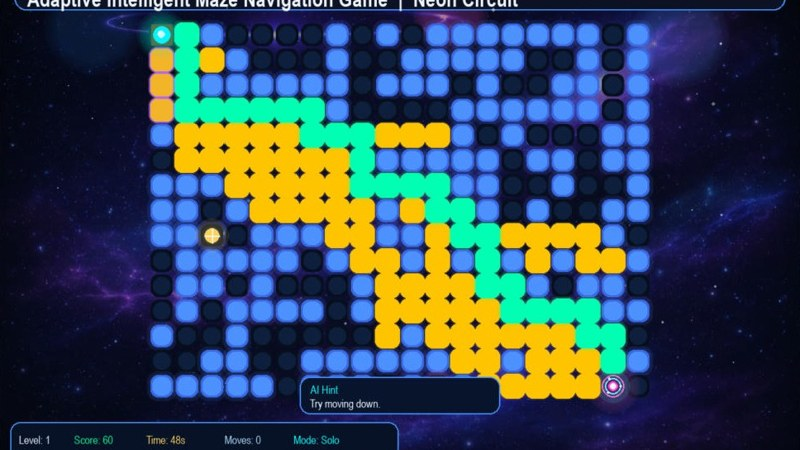
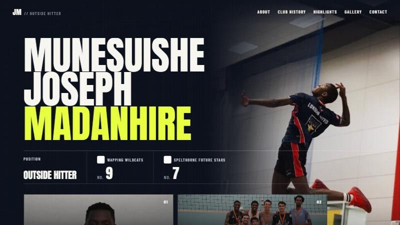

<picture>
  <source media="(prefers-color-scheme: dark)" srcset="assets/banner-dark.svg">
  <source media="(prefers-color-scheme: light)" srcset="assets/banner-light.svg">
  
</picture>

### 👋 About me

I'm a final-year ICT student at **Arrupe Jesuit University** in Harare. I build practical web platforms with **Django and React**, and use AI to solve real problems in Zimbabwe.

### ⚡ Currently building

- **[UniCatalyst](https://uniconnect-online.vercel.app)**: AI that matches students to internships, collaborators and paid work, now piloting at Arrupe Jesuit University
- **[MazeVerse AI](https://github.com/Cjclaud/MazeVerse-AI)**: an adaptive maze game with live A\* and BFS pathfinding
- 🤝 Student President of the UniConnect (now UniCatalyst) team with **Enactus Arrupe**

### 📂 Featured projects

<table>
  <tr>
    <td width="33%" valign="top">
      
      <h4>MazeVerse AI</h4>
      
Adaptive maze game with live A* and BFS search, an AI rival, and a phone race mode with a quiz.

      
<code>Python</code> <code>Pygame</code> <code>Flask</code>

      <a href="https://github.com/Cjclaud/MazeVerse-AI"><b>View repository →</b></a>
    </td>
    <td width="33%" valign="top">
      
      <h4>UniCatalyst</h4>
      
AI-matched internships, collaborators and paid student work, with Paynow escrow and a trust score earned from real work.

      
<code>Django</code> <code>React</code> <code>AI</code> <code>Paynow</code>

      <a href="https://uniconnect-online.vercel.app"><b>Visit live site →</b></a>
    </td>
    <td width="33%" valign="top">
      
      <h4>Athlete Portfolio</h4>
      
Portfolio website for volleyball outside hitter Munesuishe Joseph Madanhire, with club history, highlights and a gallery.

      
<code>Web</code> <code>Vercel</code>

      <a href="https://volleyball-topaz.vercel.app"><b>Visit live site →</b></a>
    </td>
  </tr>
</table>

### 🧰 Tech stack

  
  
  
  
  
  
  
  
  

### 🔗 Let's connect

  
  

Open to internships, collaborations and anything that puts useful tech in people's hands.
