<picture>
  <source media="(prefers-color-scheme: dark)" srcset="assets/banner-dark.svg">
  <source media="(prefers-color-scheme: light)" srcset="assets/banner-light.svg">
  
</picture>

### About me

I'm a final-year ICT student at **Arrupe Jesuit University** in Harare. I build web platforms with **Django and React**, and I like using AI to solve problems that matter here in Zimbabwe, not just in demos.

- 🎮 **Shipped:** [MazeVerse AI](https://github.com/Cjclaud/MazeVerse-AI), a maze game with live A\* and BFS pathfinding, an AI rival, and a phone-based race mode
- 🧠 **Building:** UniSphere AI, an AI assistant for students' research and study (Django + React)
- 🤝 **Leading:** UniConnect, a student freelance marketplace, as Student President with Enactus Arrupe
- 🕹️ **Learning:** mobile game development in Unity

### Featured project

<table>
  <tr>
    <td width="50%">
      
    </td>
    <td width="50%">
      <h3><a href="https://github.com/Cjclaud/MazeVerse-AI">MazeVerse AI</a></h3>
      
A desktop maze game in Python and Pygame. Watch A* and BFS search the maze step by step, race an AI rival, or join from your phone with a QR code and finish with a quiz.

      

        
        
        
      

      <a href="https://github.com/Cjclaud/MazeVerse-AI/releases/latest"><b>⬇ Download for Windows</b></a>
    </td>
  </tr>
</table>

### Tech I use

  
  
  
  
  
  
  
  
  

### Let's connect

  
  

Open to internships, collaborations and anything that puts useful tech in people's hands.
